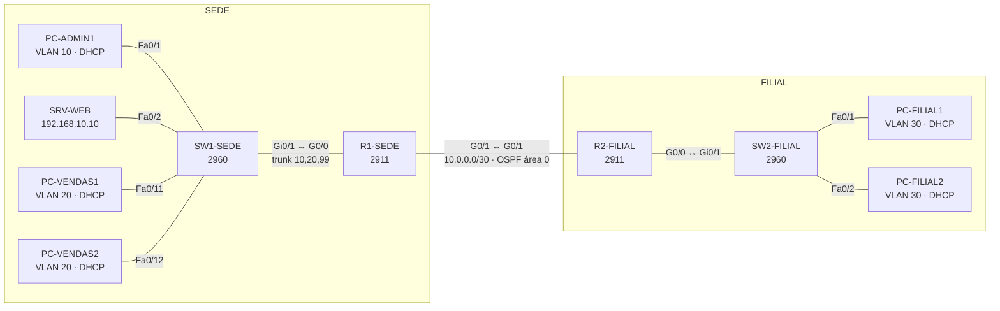

# Lab de Redes: Sede + Filial (Cisco Packet Tracer) 🌐

Rede de uma pequena empresa com **sede** e **filial**, montada e configurada no Cisco Packet Tracer.

**Tecnologias:** VLANs · Trunk 802.1Q · Router-on-a-stick (roteamento entre VLANs) · DHCP · OSPF · ACLs · SSH · Port-security

## Topologia




## Requisitos implementados

1. **Segmentação por VLANs** na sede: Admin (10), Vendas (20) e Gestão (99, VLAN nativa e de gestão).
2. **Roteamento entre VLANs** com router-on-a-stick (subinterfaces 802.1Q no R1).
3. **DHCP** nos routers para todas as LANs, com os primeiros 10 endereços reservados para equipamentos fixos.
4. **OSPF (área 0)** entre a sede e a filial, com interfaces passivas nas LANs.
5. **ACL estendida:** a rede de Vendas só consegue aceder ao servidor web/DNS da rede Admin (HTTP e DNS). O resto da rede Admin e a rede de Gestão ficam bloqueados para Vendas.
6. **Segurança:** acesso remoto só por SSH v2, palavras-passe cifradas, banner, port-security nas portas de acesso, BPDU guard e portas não usadas desligadas numa VLAN à parte.

## Tabela de endereçamento

| Equipamento | Interface | Endereço IP | Máscara | Gateway |
|---|---|---|---|---|
| R1-SEDE | G0/0.10 | 192.168.10.1 | 255.255.255.0 | — |
| R1-SEDE | G0/0.20 | 192.168.20.1 | 255.255.255.0 | — |
| R1-SEDE | G0/0.99 | 192.168.99.1 | 255.255.255.0 | — |
| R1-SEDE | G0/1 | 10.0.0.1 | 255.255.255.252 | — |
| R2-FILIAL | G0/0 | 192.168.30.1 | 255.255.255.0 | — |
| R2-FILIAL | G0/1 | 10.0.0.2 | 255.255.255.252 | — |
| SW1-SEDE | VLAN 99 | 192.168.99.2 | 255.255.255.0 | 192.168.99.1 |
| SW2-FILIAL | VLAN 30 | 192.168.30.2 | 255.255.255.0 | 192.168.30.1 |
| SRV-WEB | NIC | 192.168.10.10 | 255.255.255.0 | 192.168.10.1 |
| PCs | NIC | DHCP | DHCP | DHCP |

## VLANs e portas

| VLAN | Nome | Rede | Portas |
|---|---|---|---|
| 10 | ADMIN | 192.168.10.0/24 | SW1 Fa0/1–10 |
| 20 | VENDAS | 192.168.20.0/24 | SW1 Fa0/11–20 |
| 99 | GESTAO (nativa) | 192.168.99.0/24 | trunk SW1 Gi0/1 |
| 30 | FILIAL | 192.168.30.0/24 | SW2 Fa0/1–20, Gi0/1 |
| 999 | NAO-USADAS | — | portas livres (desligadas) |

## Como montar

1. Coloca no Packet Tracer: 2 routers **2911**, 2 switches **2960**, 1 **Server-PT** e 5 **PC-PT**.
2. Liga os cabos (cabo direto *Copper Straight-Through*) como na tabela:

   | De | Para |
   |---|---|
   | R1 G0/0 | SW1 Gi0/1 |
   | R1 G0/1 | R2 G0/1 |
   | R2 G0/0 | SW2 Gi0/1 |
   | PC-ADMIN1 | SW1 Fa0/1 |
   | SRV-WEB | SW1 Fa0/2 |
   | PC-VENDAS1 / PC-VENDAS2 | SW1 Fa0/11 / Fa0/12 |
   | PC-FILIAL1 / PC-FILIAL2 | SW2 Fa0/1 / Fa0/2 |

3. Cola cada ficheiro da pasta [`configs/`](configs/) no CLI do equipamento respetivo.
4. **Servidor:** IP 192.168.10.10/24, gateway 192.168.10.1, DNS 192.168.10.10. Em *Services*, liga o HTTP e o DNS e cria um registo `www.lab.local` → 192.168.10.10.
5. **PCs:** em *Desktop → IP Configuration*, escolhe **DHCP**.

> As palavras-passe (`Cisco123!`) são só para o laboratório.

## Verificação

| Teste | Comando / ação | Resultado esperado |
|---|---|---|
| VLANs criadas | `show vlan brief` (SW1) | VLANs 10, 20, 99 e 999 com as portas certas |
| Trunk | `show interfaces trunk` (SW1) | Gi0/1 em trunk, nativa 99, VLANs 10,20,99 |
| DHCP | `ipconfig` nos PCs | Endereços a partir de .11 na rede certa |
| Vizinhança OSPF | `show ip ospf neighbor` (R1) | R2 (2.2.2.2) em estado FULL |
| Rotas OSPF | `show ip route ospf` (R1) | 192.168.30.0/24 aprendida por OSPF (O) |
| Sede ↔ Filial | `ping 192.168.30.x` a partir do PC-ADMIN1 | ✅ Responde |
| Vendas → web | Browser do PC-VENDAS1 → `http://www.lab.local` | ✅ Abre a página |
| Vendas → Admin | `ping 192.168.10.x` a partir do PC-VENDAS1 | ❌ Bloqueado pela ACL |
| Vendas → Filial | `ping 192.168.30.x` a partir do PC-VENDAS1 | ✅ Responde |
| ACL | `show access-lists` (R1) | Contadores de *matches* a subir |
| SSH | `ssh -l admin 192.168.99.1` a partir do PC-ADMIN1 | ✅ Pede a palavra-passe |
| Telnet bloqueado | `telnet 192.168.99.1` | ❌ Recusado |

> Nota: como a ACL filtra o tráfego que **sai** de Vendas, um ping de Admin para Vendas também falha (a resposta é bloqueada). Isso é o comportamento esperado neste lab.

## Estrutura do repositório

```
lab-redes-packet-tracer/
├── README.md
├── lab-sede-filial.pkt      ← ficheiro do Packet Tracer
├── configs/
│   ├── R1-SEDE.txt
│   ├── R2-FILIAL.txt
│   ├── SW1-SEDE.txt
│   └── SW2-FILIAL.txt
└── screenshots/
```

## Ideias para evoluir

- Redundância de gateway com HSRP e um segundo router na sede
- NAT/PAT e ligação a um "ISP" simulado
- Wi-Fi com WLC e Access Points para uma rede de convidados
- Syslog e NTP centralizados no servidor

## Autor

**Guilherme Martins**, CTeSP em Redes e Sistemas Informáticos e estudante de Engenharia Informática no IPCB.
[LinkedIn](https://www.linkedin.com/in/guilherme-martins-158279309/) · [GitHub](https://github.com/gui198gui)
